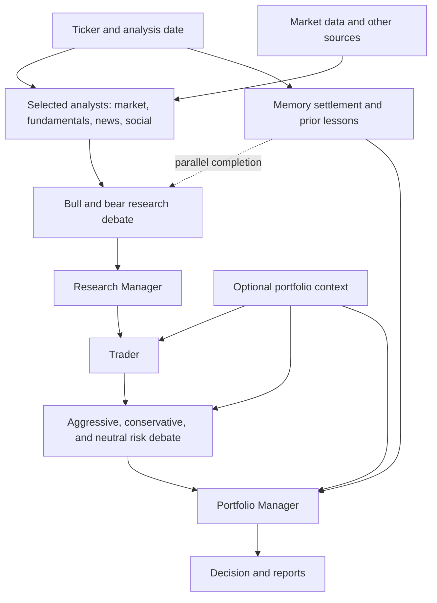
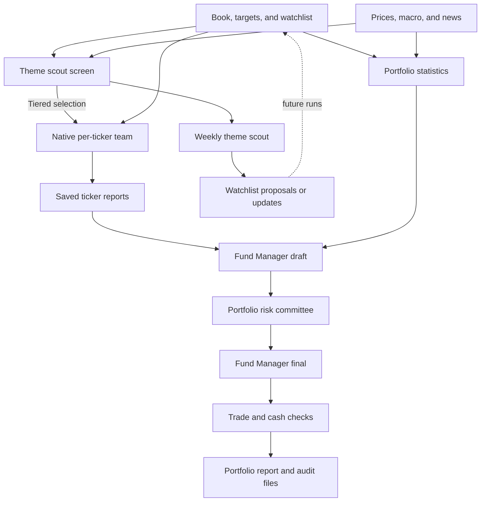

## Purpose

TradingAgents is a Python framework and CLI for multi-agent financial analysis. A LangGraph workflow coordinates analysts, researchers, a trader, and risk and portfolio managers to produce a trading decision and reports.

## Layout

- `tradingagents/graph/` builds and runs the workflow; `tradingagents/agents/` contains agent behavior and state.
- `tradingagents/dataflows/` routes market data to vendors; `tradingagents/llm_clients/` handles model providers.
- `tradingagents/memory/`, `backtest.py`, `portfolio.py`, and reporting modules support persistence, evaluation, portfolio context, and reports.
- `cli/` implements the interactive and headless command; `main.py` is a Python usage example.
- `tests/` contains the pytest suite; `.github/workflows/ci.yml` defines CI.
- `tradingagents/default_config.py` holds defaults and environment overrides; `.env.example` documents environment settings.
- `addons/fund_manager/` adds portfolio-wide analysis and a risk committee; `addons/theme_scout/` adds a market-theme scout, watchlist curator, and quantitative screen. Shared addon modules manage agent configuration, macro data, costs, and watchlist history.

### Trading workflow

`GraphSetup.setup_graph` explicitly registers four selectable analysts: market (prices and indicators), fundamentals (company data and filings), news (including macro and prediction markets), and social sentiment. They run in parallel, alongside memory settlement, before the bull/bear research debate. The Research Manager produces a plan, the Trader proposes an action, and aggressive, conservative, and neutral risk debaters feed the final Portfolio Manager decision. Native runs normally use the quick model for analysts, researchers, risk debaters, and trader, and the deep model for managers; addon seat configuration can override individual models.

| Component | Description |
| --- | --- |
| Ticker and analysis date | Identify the instrument and the date for the run. |
| Selected analysts | Gather evidence and produce reports in parallel. |
| Market data and other sources | Supply prices, fundamentals, news, macro, and sentiment inputs. |
| Memory settlement and prior lessons | Runs alongside analysts; the workflow waits for it before the debate, and the Portfolio Manager receives its lessons. |
| Bull and bear research debate | Weighs the analysts' reports from opposing perspectives. |
| Research Manager | Synthesizes the debate into an investment plan. |
| Trader | Turns the plan into a proposed action. |
| Risk debate | Evaluates the proposal from three risk perspectives. |
| Optional portfolio context | Supplies holdings and cash to the trader, risk debaters, and Portfolio Manager when provided. |
| Portfolio Manager | Weighs the evidence and produces the final decision. |
| Decision and reports | Research outputs; the backtest scores decisions rather than simulating orders. |

Agent handoffs are represented in `tradingagents/agents/state.py`; analyst registration also involves `graph/analyst_execution.py` and `graph/setup.py`. The Research Manager, Trader, and Portfolio Manager use structured schemas when supported, rendered as reports. Portfolio context is optional; no supplied portfolio differs from an explicitly empty one. Reports and decisions are research outputs. `backtest.py` scores independent decisions rather than simulating fills, cash, or a changing portfolio.

Data routes through `dataflows/router.py` with vendor-specific implementations; macro and prediction-market enrichment is optional. Historical data integrity needs source-by-source attention: social feeds are not archived point-in-time. Memory and optional checkpoints persist state across runs; see the README for paths and controls.

### Addon workflow

The addons sit around the native graph rather than adding nodes to it. `run_portfolio.ps1` runs preflight checks, optionally runs native analysis per holding or candidate via `run_native.py`, and then runs the fund manager over the latest available reports and portfolio statistics. `run_native.py` installs the addon seat configuration and optionally adds macro context when `ARGUS_MACRO_CONTEXT_FILE` is set. The fund manager drafts a portfolio plan, runs a separate aggressive/conservative/neutral committee, and produces a final plan with deterministic trade and cash checks. With zero risk rounds the draft is the final plan. A failed native run is reported, but the fund manager may still run with missing or older reports.

| Component | Description |
| --- | --- |
| Book, targets, and watchlist | Runtime inputs in `data/`; targets provide guidance, budget, cash, and curator policy. |
| Prices, macro, and news | External inputs for the screen and portfolio analysis. |
| Theme scout screen | Ranks holdings and candidates without an LLM; its selection can feed tiered native runs. |
| Native per-ticker team | Optionally refreshes reports for holdings and selected candidates. |
| Saved ticker reports | Latest available native analyses consumed by the fund manager. |
| Portfolio statistics | Quantitative portfolio, risk, regime, and candidate measures. |
| Fund Manager draft | Produces a proposed whole-book plan from reports and statistics. |
| Portfolio risk committee | Debates the draft; skipped when risk rounds are zero. |
| Fund Manager final | Incorporates the debate when enabled. |
| Trade and cash checks | Recompute and check proposed trades and post-trade cash and weights. |
| Portfolio report and audit files | Record the plan, inputs, debate, checks, and usage. |
| Weekly theme scout | Uses macro, news, and relative strength for theme and watchlist proposals. |
| Watchlist proposals or updates | Shadow mode writes proposals; outside shadow mode the scout can update the watchlist and log changes. |

`addons/fund_manager/targets.json` is a template, not proof of current policy: the PowerShell runner copies it to `data/targets.json` only if absent. The runner requires `data/my_book.json` and creates an empty watchlist if needed. These runtime files are ignored by Git, and this checkout currently has no `data/` directory. Docker Compose defaults to a named volume; the addon scripts expect the project `data/` files in the container, so configure `TRADINGAGENTS_DATA_DIR` to the intended host data directory when using that setup.

The weekly scout can change `data/watchlist.json` after its configured shadow period unless `-KeepWatchlist` is used. Screen, dry-run and no-LLM modes avoid that update. Budget gates in the PowerShell launchers use recorded spend and estimated next-run cost before paid calls; they are estimates, not a guaranteed spending ceiling. See the addon READMEs and code for current options and safeguards.

## Commands

- Python 3.11 or later is required. Install development dependencies with `pip install -e ".[dev]"`.
- Run `pytest -q` for the default suite; integration-marked tests are excluded by default and can be selected with `pytest -m integration` when external services are available.
- Run `ruff check .` for the CI lint check.
- Run `tradingagents` or `python -m cli.main` for the CLI. Live analyses require configured LLM and data providers and may incur external usage costs.
- `docker compose run --rm tradingagents` runs the packaged CLI in Docker.
- On PowerShell with Docker and runtime data configured, `addons/fund_manager/run_portfolio.ps1 -NoLLM` produces a portfolio snapshot; `addons/theme_scout/run_theme_scout.ps1 -Screen` runs the quantitative screen. Both fetch external data.
- Addon offline checks are `python addons/fund_manager/check_offline.py`, `python addons/theme_scout/check_offline.py`, `python addons/check_agent_config.py`, `python addons/check_cost_ledger.py`, and `python addons/check_macro_panel.py` (using the project dependencies).

## Conventions

- Package configuration, dependencies, test markers, and Ruff settings live in `pyproject.toml`. CI tests Python 3.11–3.14 and includes a non-UTC run.
- Keep provider-specific behavior in the appropriate LLM client or data vendor and route shared behavior through the existing graph and dataflow layers.
- The memory log is enabled by default; checkpoint resume is opt-in. Paths and other runtime settings can be overridden through documented environment variables.
- Do not expose local `.env` credentials. Tests marked integration depend on external services and are not part of the default suite.

## Logs

- 2026-11-07 19:03 — Initialized project guide from repository configuration, documentation, and CI.
- 2026-11-07 19:05 — Traced the team workflow, data and evaluation boundaries, and unavailable addon gitlink.
- 2026-11-07 19:14 — Added a diagram of the current analysis workflow and its inputs.
- 2026-11-08 05:11 — Documented the available addons, their workflow, inputs, and operating boundaries on develop.
- 2026-11-08 05:16 — Clarified addon model overrides and optional macro context.
